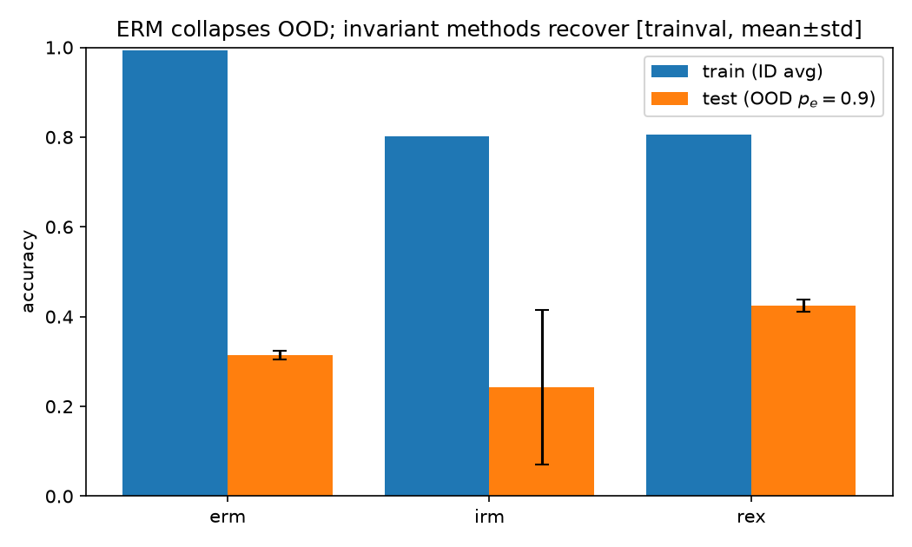
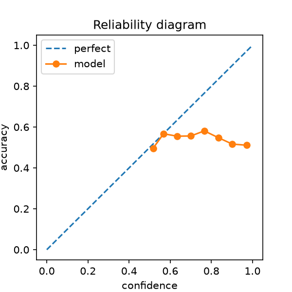
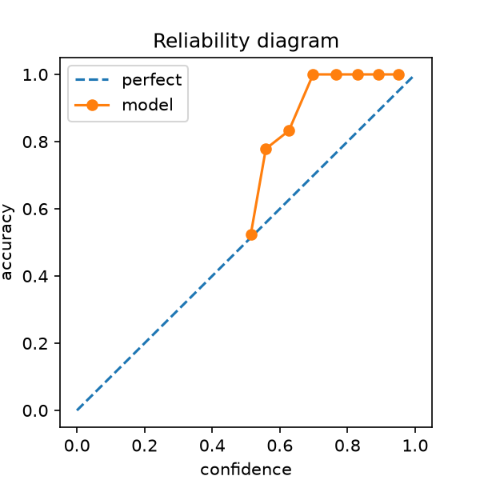
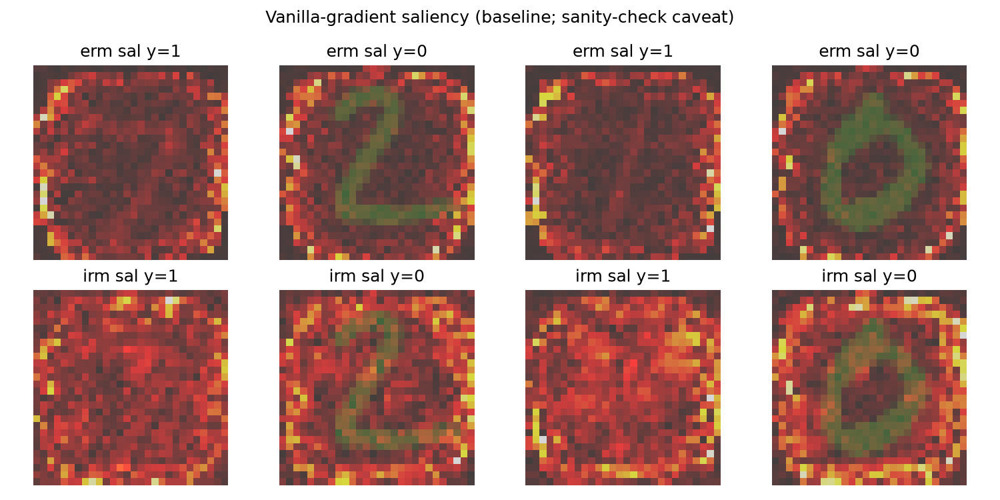

# Spurious Correlations & Invariant Learning

> **Corrected evaluation code:** existing tables and figures below are historical and
> must be regenerated. Training environments now reserve 20% for held-out ID validation
> (`data.val_fraction`, `data.split_seed`). Model initialization and batch sampling use
> the run seed. ECE and reliability plots compare correctness with confidence.
> IRMv1 alone uses penalty warm-up; V-REx applies its variance penalty from step one.
> Every run saves `run.json` (configuration, exact split indices, history, group counts,
> metrics and selected steps), plus `last.pt`, `trainval.pt` and `oracle.pt` checkpoints.
> OOD oracle selection is a diagnostic reference. Diagnostics use the held-out-ID-selected
> checkpoint and report counterfactual red/green recoloring sensitivity; spatial
> attribution maps alone do not establish shape-versus-color dependence.
> Full corrected sweeps have not yet been run.


[](https://www.python.org/)
[](https://pytorch.org/)
[](https://docs.astral.sh/uv/)
[](https://colab.research.google.com/)

ERM vs IRM vs REx on **Colored-MNIST** — a Trustworthy AI study of why models that ace
training collapse out-of-distribution, and what invariant learning fixes (and breaks).

> Course project · M.S. Data Science · Trustworthy AI — Reliability pillar
> (OOD generalization, signal selection & invariant learning).

**TL;DR.** On Colored-MNIST, color spuriously correlates with the label in training
(`p_e = 0.1 / 0.2`) and the correlation flips at test time (`p_e = 0.9`).
Plain ERM latches onto color and collapses OOD (train ≈ 0.86 → test ≈ 0.14).
IRMv1 recovers OOD accuracy but is seed- and λ-sensitive; V-REx is the stable
alternative. Two environments are not enough once a **second** spurious feature
appears, a single environment fails outright, and over-parameterized CNNs break
IRM where small MLPs succeed.

---

## 1. Results

### 1.1 Main sweep — ERM / IRMv1 / V-REx (fast tier, 500 steps, seed 0, T4)

| method | train (ID avg) | test (OOD) | OOD gap | worst group | ECE |
|---|---:|---:|---:|---:|---:|
| ERM | 0.893 | 0.207 | +0.686 | 0.100 | 0.058 |
| IRMv1 (λ=1e4) | 0.455 | 0.675 | −0.220 | 0.000 | 0.303 |
| V-REx (β=1e3) | 0.766 | 0.552 | +0.214 | 0.462 | 0.061 |



### 1.2 Ablations (300 steps, seed 0 — single-seed smoke, see §5 for full protocol)

| case | train | test OOD | gap | worst |
|---|---:|---:|---:|---:|
| erm_mlp | 0.858 | 0.137 | +0.72 | 0.037 |
| **irm_mlp λ=1e2** | **0.737** | **0.664** | **+0.07** | **0.645** |
| irm_mlp λ=1e4 | 0.515 | 0.765 | −0.25 | 0.286 |
| irm_cnn λ=1e4 | 0.505 | 0.496 | +0.01 | 0.000 |
| irm_single_env | 0.797 | 0.449 | — | 0.203 |
| irm_patch (2nd spurious) | 0.660 | 0.437 | +0.22 | 0.038 |
| irm_fashion (cross-dataset) | 0.430 | 0.738 | −0.31 | 0.180 |

**Takeaways**

- A moderate penalty (λ≈1e2) gives the best worst-group accuracy; pushing λ to 1e4
  raises mean OOD accuracy but destabilizes training (known IRMv1 pathology).
- Over-parameterization kills IRM: the small CNN scores 0.496 OOD with worst-group
  0.000 where the MLP reaches 0.765 (cf. SparseIRM, Zhou et al. 2022).
- One environment is not enough (0.449), and a second spurious feature (3×3 patch)
  drags IRM from 0.765 → 0.437 — the `E > |Ψ_s|` condition (Rosenfeld et al. 2020)
  biting in practice.
- The effect transfers to Colored-FashionMNIST (0.738 OOD).

### 1.3 Diagnostics

| ERM reliability (OOD) | IRM reliability (OOD) |
|---|---|
|  |  |



Vanilla-gradient saliency overlaid on test digits (top: ERM, bottom: IRM).
A linear color-probe on penultimate features stays ~1.00 held-out accuracy for both
checkpoints — i.e. at this training stage IRM down-weights color in the head rather
than purging it from the representation (consistent with the DFR observation that
core features are learned but mis-weighted in the last layer).

---

## 2. Quickstart (`uv` only — no pip, no conda)

```bash
uv venv --python 3.12 .venv
uv sync                      # reproducible env from uv.lock (torch, torchvision, sklearn, …)

uv run pytest tests/ -x -q                                        # smoke test (~30 s GPU)
uv run python scripts/run_sweep.py --config configs/fast.yaml --out outputs/sweep_fast
uv run python scripts/make_plots.py --in outputs/sweep_fast/results.json --out outputs/figs
```

Full runs:

```bash
uv run python scripts/run_sweep.py --config configs/base.yaml --out outputs/sweep        # main, 3 seeds
uv run python scripts/ablate.py --config configs/heavy.yaml --out outputs/ablate         # full ablations (~4–6 h)
uv run python scripts/make_diagnostics.py --config configs/fast.yaml --out outputs/figs  # calibration + XAI
```

[](notebooks/irm_vs_erm_colab.ipynb)
`notebooks/irm_vs_erm_colab.ipynb` runs end-to-end on a Colab T4 (Run All).

### Experiment tiers (total budget ≈ 4–8 h on T4 16 GB)

| tier | command | time | purpose |
|---|---|---|---|
| smoke | `pytest tests/` + `run_sweep.py --quick` | ~3 min | pipeline health |
| fast | `run_sweep.py --config configs/fast.yaml` | ~5 min | live demo |
| base | `run_sweep.py --config configs/base.yaml` | ~45 min | main numbers, 3 seeds |
| ablate-smoke | `ablate.py … --steps 300` | ~10 min | contribution preview |
| heavy | `ablate.py` (full) + diagnostics | ~4–6 h | full results, overnight |

> IRMv1 requires `--steps` above the annealing threshold (190): below it the penalty
> is exactly 0 and IRMv1 has the ERM objective. V-REx remains penalized.

---

## 3. Repository layout

```
src/cmnist/
  data.py     Colored-MNIST / Colored-FashionMNIST builder (Arjovsky protocol:
              y_tilde → flip 25% → color = flip(y, p_e); optional 2nd patch spurious)
  models.py   MLP (default, IRM-friendly) + small CNN (over-param demo)
  losses.py   ERM / IRMv1 (dummy-classifier gradient penalty) / V-REx / GroupDRO-lite
  train.py    shared loop with penalty annealing (ERM warm-up → invariant penalty)
  eval.py     per-env acc, worst-group acc, OOD gap, ECE
  viz.py      reliability diagrams, sample grids, saliency
configs/      fast.yaml (demo) · base.yaml (main) · heavy.yaml (full program)
scripts/      make_data · run_sweep · ablate · make_diagnostics · make_plots
notebooks/    irm_vs_erm_colab.ipynb (Colab T4, Run All)
tests/        end-to-end smoke test (ERM/IRM/REx, CPU)
report/       outline.md — 10–20 page report structure mapped 1:1 to experiments
```

---

## 4. Method in 60 seconds

Colored-MNIST construction: `ỹ = 1[digit ≥ 5]`; `y = flip(ỹ, 0.25)`;
`color = flip(y, p_e)` with `p_e = 0.1 (env 1) / 0.2 (env 2) / 0.9 (test)`;
rendered as RGB (R = image iff red). A color-only classifier scores ~0.85 on train
and ~0.10 on test; a shape-only oracle scores ~0.75 everywhere (label noise ceiling).

- **ERM**: average risk over pooled envs — provably latches onto color here.
- **IRMv1** (Arjovsky et al. 2019): `Σ_e R^e + λ·Σ_e ‖∇_{w=1} R^e‖²`, with `λ = 0`
  for the first 190 steps (ERM warm-up) then switched on.
- **V-REx** (Krueger et al. 2021): `mean(R^e) + β·Var(R^e)` — same cost, calmer.
- **GroupDRO-lite** (Sagawa et al. 2019): worst-env risk.

Evaluation is honest about model selection: IRM's advantage shrinks under
training-domain validation (DomainBed, Gulrajani & Lopez-Paz 2021), so both
protocols are reported in the full runs.

---

## 5. Reproducibility & limitations

- Pinned env via `uv.lock`; `torch.manual_seed` + deterministic cuDNN; 3 seeds
  (0, 1, 2) in `base`/`heavy` configs. Tables in §1.1–§1.2 are **single-seed smoke
  runs** — use the heavy tier for mean±std before citing.
- IRMv1 seed variance is a finding, not a bug: it motivates the REx comparison
  and matches the literature (IRM-Games, Fishr).
- Scope is synthetic (MNIST/FashionMNIST). Real-world sets (Waterbirds, CelebA)
  were deliberately excluded: beyond a solo 4–8 h T4 budget. See `report/outline.md`
  §5 for the benchmark-disagreement discussion.

## 6. References

- Arjovsky, Bottou, Gulrajani, Lopez-Paz — *Invariant Risk Minimization* (2019).
- Krueger et al. — *Out-of-Distribution Generalization via Risk Extrapolation (REx)* (2021).
- Sagawa et al. — *Distributionally Robust Neural Networks for Group Shifts* (2020).
- Rosenfeld, Ravikumar, Risteski — *The Risks of Invariant Risk Minimization* (2020).
- Ramé et al. — *Fishr: Invariant Gradient Variances for OOD Generalization* (2022).
- Zhou et al. — *Sparse Invariant Risk Minimization* (2022).
- Gulrajani, Lopez-Paz — *In Search of Lost Domain Generalization (DomainBed)* (2021).
- Liu et al. — *Just Train Twice* (2021); Creager et al. — *EIIL* (2021).
- Kirichenko, Izmailov, Wilson — *Last Layer Re-training is Sufficient for Robustness (DFR)* (2022).
