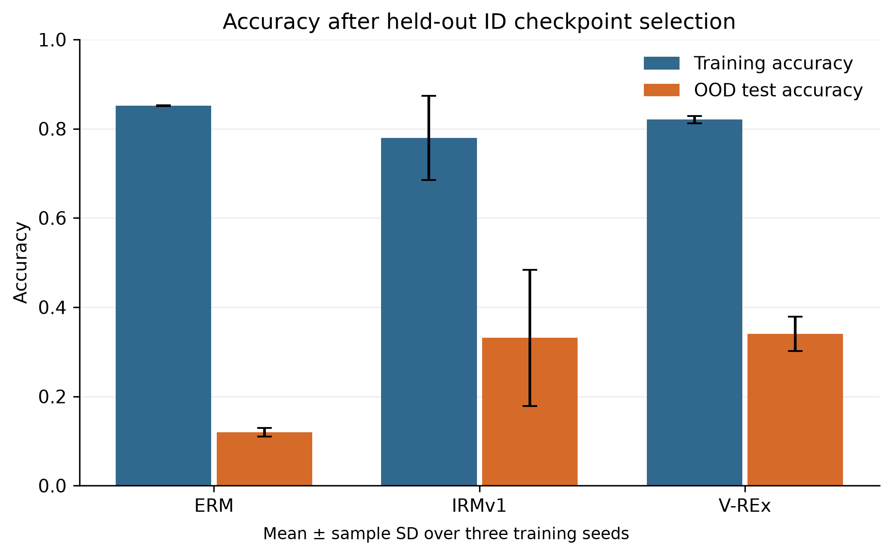
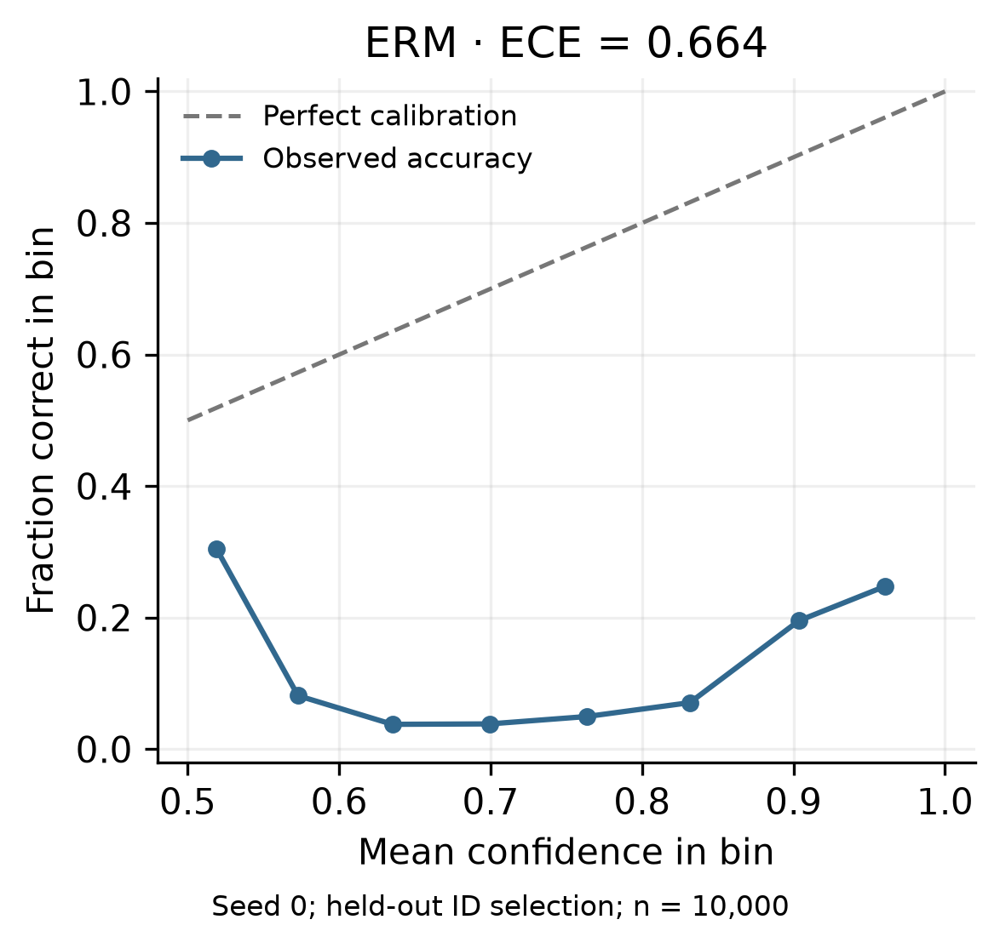
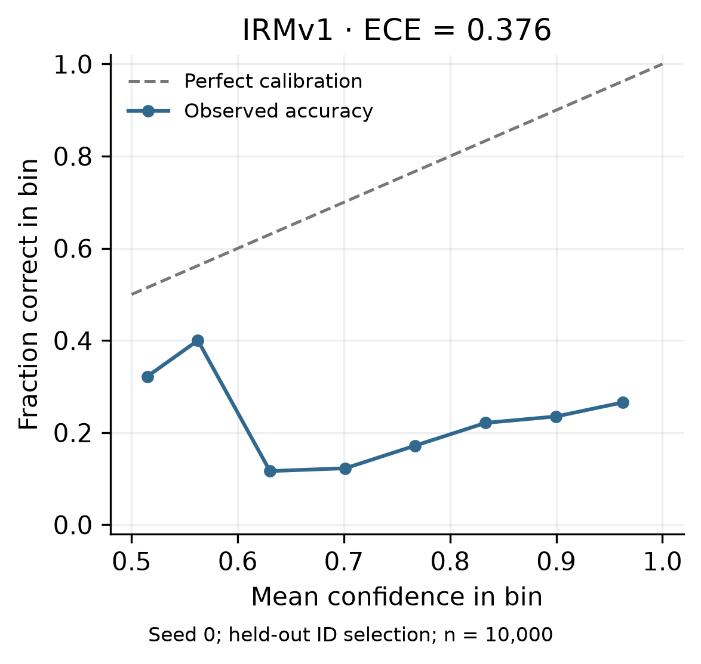
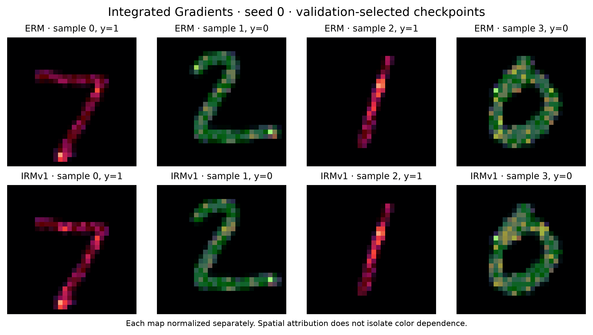
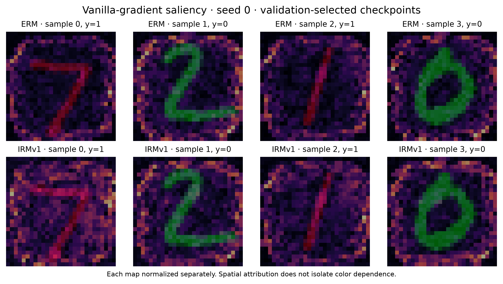
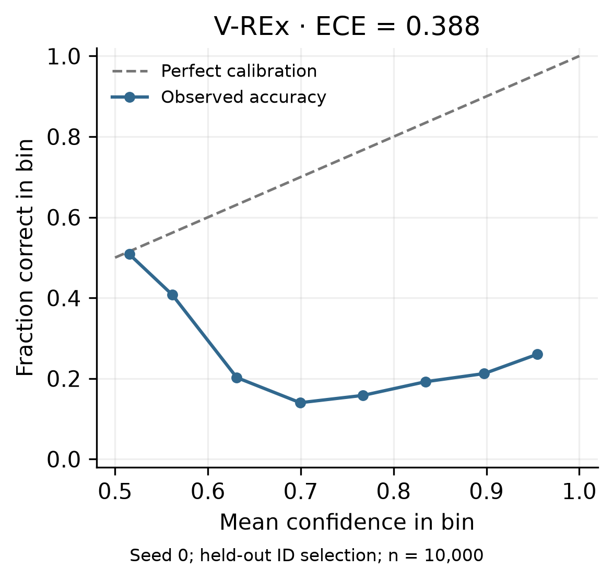
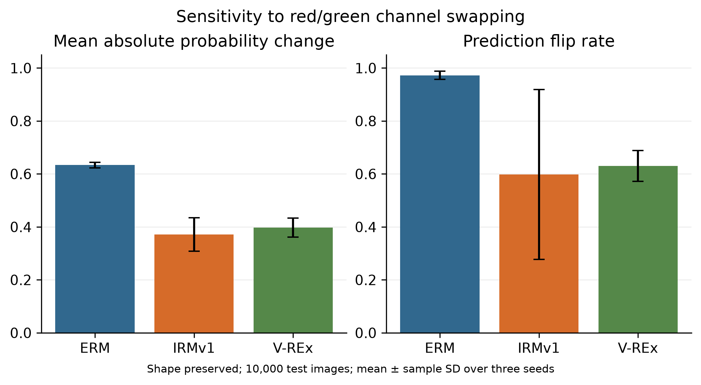

# Corrected experiment tables and figures

These assets use the corrected, audited experiment outputs. Training uses an 80/20 split within each training environment; checkpoints are selected on held-out ID accuracy.

Three training seeds (0, 1, 2). In the six core tables, OOD and worst-group accuracy are mean ± sample SD; the other metrics are means. Supplementary tables show mean ± sample SD throughout. The OOD gap is training accuracy minus OOD accuracy.

The reliability and attribution figures show seed 0 only. Their ECE values therefore differ from the three-seed average in the tables. Spatial attribution maps do not isolate shape-versus-color reliance.

The report prose and PDFs have not yet been reconciled with these new results.

## Main comparison

| Method | Train accuracy | OOD accuracy | Gap | Worst group | ECE |
| --- | --- | --- | --- | --- | --- |
| ERM | 0.851 | 0.119 ± 0.010 | 0.732 | 0.005 ± 0.005 | 0.652 |
| IRMv1 | 0.779 | 0.331 ± 0.152 | 0.448 | 0.074 ± 0.058 | 0.411 |
| V-REx | 0.820 | 0.340 ± 0.038 | 0.480 | 0.236 ± 0.045 | 0.340 |

## Checkpoint-selection comparison

| Method | Held-out ID selection | OOD oracle | Last checkpoint |
| --- | --- | --- | --- |
| ERM | 0.119 ± 0.010 | 0.338 ± 0.020 | 0.280 ± 0.017 |
| IRMv1 | 0.331 ± 0.152 | 0.759 ± 0.075 | 0.650 ± 0.108 |
| V-REx | 0.340 ± 0.038 | 0.572 ± 0.028 | 0.360 ± 0.065 |

## Penalty sweep

| Method | Penalty | Train | OOD | Gap | Worst group | ECE |
| --- | --- | --- | --- | --- | --- | --- |
| IRMv1 | λ=100 | 0.829 | 0.284 ± 0.067 | 0.545 | 0.103 ± 0.083 | 0.404 |
| IRMv1 | λ=1000 | 0.778 | 0.337 ± 0.153 | 0.441 | 0.081 ± 0.064 | 0.405 |
| IRMv1 | λ=10000 | 0.779 | 0.331 ± 0.152 | 0.448 | 0.074 ± 0.058 | 0.411 |
| IRMv1 | λ=30000 | 0.780 | 0.331 ± 0.151 | 0.449 | 0.074 ± 0.058 | 0.411 |
| V-REx | β=100 | 0.872 | 0.221 ± 0.020 | 0.651 | 0.118 ± 0.021 | 0.559 |
| V-REx | β=1000 | 0.820 | 0.340 ± 0.038 | 0.480 | 0.236 ± 0.045 | 0.340 |
| V-REx | β=10000 | 0.797 | 0.417 ± 0.045 | 0.379 | 0.297 ± 0.099 | 0.146 |

## Individual seeds

| Method | Penalty | Seed 0: OOD / worst | Seed 1: OOD / worst | Seed 2: OOD / worst |
| --- | --- | --- | --- | --- |
| IRMv1 | λ=100 | 0.3048 / 0.1621 | 0.2083 / 0.0083 | 0.3379 / 0.1378 |
| IRMv1 | λ=1000 | 0.2817 / 0.1051 | 0.2188 / 0.0078 | 0.5093 / 0.1291 |
| IRMv1 | λ=10000 | 0.2765 / 0.0968 | 0.2137 / 0.0080 | 0.5035 / 0.1165 |
| IRMv1 | λ=30000 | 0.2796 / 0.1011 | 0.2123 / 0.0078 | 0.5017 / 0.1131 |
| V-REx | β=100 | 0.1985 / 0.0945 | 0.2332 / 0.1222 | 0.2313 / 0.1360 |
| V-REx | β=1000 | 0.2962 / 0.1841 | 0.3668 / 0.2580 | 0.3577 / 0.2651 |
| V-REx | β=10000 | 0.4175 / 0.3374 | 0.4627 / 0.3691 | 0.3722 / 0.1837 |

## Backbones and environments

| Method | Configuration | Train | OOD | Gap | Worst group | ECE |
| --- | --- | --- | --- | --- | --- | --- |
| ERM | MLP | 0.851 | 0.119 ± 0.010 | 0.732 | 0.005 ± 0.005 | 0.652 |
| ERM | CNN | 0.849 | 0.108 ± 0.004 | 0.740 | 0.003 ± 0.004 | 0.660 |
| IRMv1 | MLP | 0.779 | 0.331 ± 0.152 | 0.448 | 0.074 ± 0.058 | 0.411 |
| IRMv1 | CNN | 0.593 | 0.599 ± 0.009 | -0.007 | 0.385 ± 0.072 | 0.096 |
| IRMv1 | Single training environment | 0.693 | 0.529 ± 0.233 | 0.164 | 0.120 ± 0.153 | 0.363 |

## Spurious features and transfer

| Method | Configuration | Train | OOD | Gap | Worst group | ECE |
| --- | --- | --- | --- | --- | --- | --- |
| ERM | Additional 3×3 patch | 0.930 | 0.138 ± 0.002 | 0.792 | 0.078 ± 0.001 | 0.786 |
| IRMv1 | Additional 3×3 patch | 0.908 | 0.114 ± 0.002 | 0.794 | 0.095 ± 0.001 | 0.791 |
| ERM | n=6{,}250 per environment | 0.959 | 0.255 ± 0.027 | 0.704 | 0.164 ± 0.023 | 0.612 |
| IRMv1 | n=6{,}250 per environment | 0.810 | 0.333 ± 0.102 | 0.478 | 0.051 ± 0.076 | 0.462 |
| ERM | Colored-FashionMNIST | 0.849 | 0.103 ± 0.001 | 0.747 | 0.000 ± 0.001 | 0.651 |
| IRMv1 | Colored-FashionMNIST | 0.710 | 0.394 ± 0.266 | 0.315 | 0.092 ± 0.134 | 0.372 |

## Calibration and recoloring (supplementary)

| Method | ECE | Recoloring: mean absolute Δp | Recoloring: flip rate |
| --- | --- | --- | --- |
| ERM | 0.652 ± 0.015 | 0.633 ± 0.010 | 0.972 ± 0.016 |
| IRMv1 | 0.411 ± 0.042 | 0.372 ± 0.063 | 0.598 ± 0.321 |
| V-REx | 0.340 ± 0.047 | 0.397 ± 0.036 | 0.630 ± 0.058 |

## Label-color group accuracy (supplementary)

| Method | y0c0 (n=489) | y0c1 (n=4473) | y1c0 (n=4508) | y1c1 (n=530) |
| --- | --- | --- | --- | --- |
| ERM | 0.992 ± 0.007 | 0.023 ± 0.027 | 0.018 ± 0.019 | 0.987 ± 0.016 |
| IRMv1 | 0.933 ± 0.040 | 0.319 ± 0.464 | 0.224 ± 0.098 | 0.787 ± 0.326 |
| V-REx | 0.913 ± 0.034 | 0.263 ± 0.004 | 0.288 ± 0.091 | 0.909 ± 0.007 |

## Figures

PNG files are 300 DPI; SVG files preserve vector plot elements.

